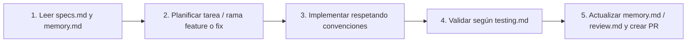

# Documentación Viva del Proyecto — IAgroCorr (`docs/`)

Esta carpeta implementa la metodología **Spec-Driven Development + Memory Bank** para **IAgroCorr**, integrando la documentación académica oficial presentada ante la cátedra de Proyecto Final de Carrera (**Anexo II — FACENA, UNNE**) con el estado real y evolutivo del código en el repositorio.

---

## Estructura de Documentos

| Archivo | Propósito | ¿Cuándo consultarlo o actualizarlo? |
| :--- | :--- | :--- |
| **[`specs.md`](./specs.md)** | **Especificación Oficial y Arquitectura:** Marco institucional (Anexo II), objetivos, metodología Scrum/Datos, arquitectura de 3 módulos, modelo espacial PostGIS, APIs y stack técnico. | Al iniciar el desarrollo de un módulo nuevo, diseñar cambios de arquitectura o verificar alineación con el PFC aprobado. |
| **[`memory.md`](./memory.md)** | **Memoria Activa (Contexto Actual):** Estado al día de la rama `main`, diferenciación entre funciones reales y maquetas (*Mago de Oz*), decisiones técnicas vigentes y próximos pasos del Sprint. | **Al abrir cada sesión de trabajo** (humana o con asistentes de IA) y al cerrar un bloque de cambios o Pull Request. |
| **[`testing.md`](./testing.md)** | **Pruebas, Validación y Entornos:** Comandos para Docker, Dev Container y entorno local Windows; checklist de QA geoespacial/UI y lineamientos para pruebas automatizadas en GeoDjango. | Antes de abrir o fusionar un Pull Request y al validar cambios en PostGIS, motor de reglas o mapas Leaflet. |
| **[`review.md`](./review.md)** | **Revisión, Hitos y Deuda Técnica:** Historial consolidado de avances del equipo, matriz de cumplimiento de objetivos del Anexo II y auditoría de mejoras pendientes. | Al cierre de cada Sprint quincenal, revisión con el Profesor Orientador o entregas parciales del PFC. |
| **[`presentacion/defensa_preliminar.html`](./presentacion/defensa_preliminar.html)** | **Presentación Interactiva 16:9 (Simulacro de Defensa PFC):** 10 diapositivas alineadas al Anexo III con cronómetro de 10 minutos, guion por orador (`Tecla N`) y exportación directa a PDF (`Ctrl + P`). | Para ensayar tiempos, proyectar en clase o actualizar avances previos a la defensa. |

---

## Flujo de Trabajo Recomendado (Equipo + Asistentes de IA)

1. **Contexto antes de codificar:** Todo colaborador o asistente de IA debe leer `specs.md` y `memory.md` para respetar las decisiones ya tomadas (puertos de PostGIS, SRIDs, autodetección de GDAL, soporte de modo oscuro, etc.).
2. **Ramas por funcionalidad o corrección:** Seguir la convención utilizada en el repositorio (`feature/...`, `fix/...`, `style/...`, `docs/...`) e integrar a `main` mediante Pull Request.
3. **Sincronización documental:** Cuando un cambio modifique modelos, rutas, infraestructura o convierta una maqueta en funcionalidad productiva, reflejarlo en `memory.md` y `review.md`.

---

## Documentos Complementarios en la Raíz

- **[`../README.md`](../README.md):** Presentación general del repositorio e inicio rápido.
- **[`../GUIA_INSTALACION.md`](../GUIA_INSTALACION.md):** Guía paso a paso detallada para configurar Docker, PostGIS y el entorno local en Windows.
