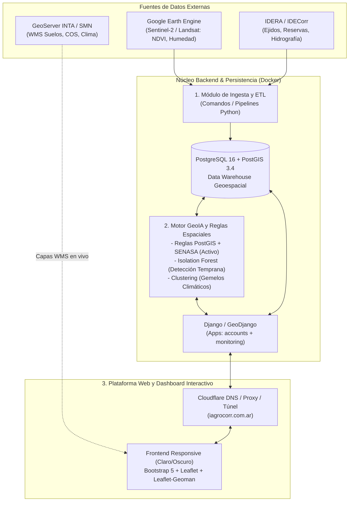

# Especificación Oficial y Técnica — IAgroCorr (`specs.md`)

Documento rector de arquitectura, alcance funcional y lineamientos técnicos de **IAgroCorr**, alineado con el **Plan de Trabajo Oficial (Anexo II)** presentado ante la Facultad de Ciencias Exactas y Naturales y Agrimensura (**FACENA - UNNE**) y actualizado con las decisiones de ingeniería adoptadas durante el desarrollo.

---

## 1. Marco Institucional y Académico (Anexo II)

- **Título del Proyecto:** “IAgroCorr” — Plataforma Web de Inteligencia Territorial Agropecuaria.
- **Encuadre:** Proyecto Final de Carrera (PFC) para la obtención del título de **Licenciado en Sistemas** (Proyecto de I+D+i / Asignatura) y participación en **Proyecto Emprende U 2026**.
- **Unidad Académica:** Facultad de Ciencias Exactas y Naturales y Agrimensura (FACENA) — Universidad Nacional del Nordeste (UNNE). Articulación interdisciplinaria con la **Facultad de Ciencias Agrarias (UNNE)** y asesores agronómicos externos.
- **Área de la Disciplina:** Inteligencia Artificial y Ciencia de Datos.
- **Palabras Clave:** Sistemas de Información Geográfica, Machine Learning, Análisis de Datos.
- **Clasificación (s/ Anexo I, pto. 3):** Desarrollo de aplicaciones/sistemas con descripción metodológica en Especificación de Requerimientos, Diseño y Desarrollo.
- **Equipo de Trabajo:**
  - **Profesor Orientador:** Aldo José Mettini (`aldo.mettini@comunidad.unne.edu.ar`).
  - **Alumno / Desarrollador:** Giovanni Oscar Piazza (LU Nº 57847 — GitHub: `@Gio-glitch04`).
  - **Alumno / Desarrollador:** Julio César Pintos (LU Nº 57904).
- **Cumplimiento Ético (Anexo II — RES 0182/18):** Declaración jurada ante el Comité de Ética en Investigación: el sistema opera exclusivamente sobre cartografía, datos agrometeorológicos, teledetección satelital y registros técnicos productivos; **no procesa datos clínicos/sensibles de personas**, muestras biológicas, organismos ni materiales peligrosos.

---

## 2. Objetivos del Proyecto

### Objetivo General
Desarrollar una plataforma de **Inteligencia Territorial** que integre datos satelitales, cartografía oficial y modelos de aprendizaje automático para optimizar la toma de decisiones estratégicas, la diversificación productiva y la gestión de riesgos ambientales en la provincia de Corrientes.

### Objetivos Específicos
1. **GeoIA:** Profundizar conocimientos en el análisis geoespacial con Inteligencia Artificial.
2. **Data Warehouse Geoespacial:** Diseñar un almacén de datos espaciales que integre capas de **IDERA**, **IDECorr**, **INTA** y **Google Earth Engine (GEE)**.
3. **Aplicación Web Multiplataforma:** Desarrollar una solución web portable, de alta disponibilidad y alto rendimiento adaptable a dispositivos móviles y de escritorio.
4. **Detección de Anomalías y Semáforo:** Implementar modelos de Machine Learning para detectar y clasificar anomalías en índices de vegetación (NDVI/NDWI) y riesgos normativos/ambientales, exponiendo diagnósticos simplificados en **formato semáforo**.
5. **Motor de Recomendación (Gemelos Climáticos):** Desarrollar un sistema de recomendación de cultivos basado en análisis de similitud (*clustering*) entre el perfil edafoclimático local y zonas productivas globales de alto rendimiento.
6. **Dashboard Interactivo:** Construir un módulo de visualización cartográfica y analítica para la toma de decisiones del productor agropecuario.

---

## 3. Metodología de Trabajo

1. **Gestión de Proyectos — Scrum Adaptado:**
   - Trabajo en dupla con **Sprints quincenales**.
   - Priorización continua de entregables de alto valor orientados a consolidar un **MVP (Producto Mínimo Viable)** sobre un *Product Backlog* gestionado en GitHub.
2. **Metodología Informática — Desarrollo Ágil Orientado a Datos + CRISP-DM:**
   - **Etapa 1 — Educción:** Relevamiento y validación de requerimientos junto a productores e ingenieros agrónomos.
   - **Etapa 2 — ETL e Integración:** Extracción, normalización y carga de capas vectoriales (IDERA, IDECorr, INTA) y series temporales satelitales (GEE / Sentinel-2).
   - **Etapa 3 — Modelado (CRISP-DM):** Entrenamiento y calibración de modelos en Python (*Isolation Forest* para anomalías vegetativas y *Clustering No Supervisado* para gemelos edafoclimáticos y segmentación).
   - **Etapa 4 — Prototipado Incremental:** Evolución iterativa de la interfaz web, mapas interactivos y servicios backend.

---

## 4. Arquitectura del Sistema (Los 3 Componentes Principales)

### Componente 1: Módulo de Ingesta y Almacenamiento Espacial (Pipeline ETL + DW)
Centraliza capas vectoriales de ordenamiento territorial de Corrientes y series temporales agrometeorológicas/satelitales en **PostgreSQL 16 + PostGIS 3.4**, separando tablas dimensionales operativas de la tabla de hechos histórica inmutable (`HechoMedicionAmbiental`).

### Componente 2: Motor de Inteligencia Artificial y Análisis Geoespacial
Dividido conceptualmente en:
- **Motor de Reglas Espaciales y Normativas (Implementado en `monitoring/rules_engine.py`):** Cruza en tiempo real geometrías PostGIS (distancias métricas proyectadas a `EPSG:3857` hacia Esteros del Iberá, red fluvial y ejidos urbanos), trazabilidad fitosanitaria según **Bandas Toxicológicas SENASA** (Clases Ia, Ib, II, III, IV) e indicadores satelitales (NDVI y humedad superficial) para emitir un `score_riesgo` (0–100) y el semáforo (`VERDE`, `AMARILLO`, `ROJO`).
- **Subsistema de Detección Temprana (En hoja de ruta ML):** Implementación del algoritmo **Isolation Forest** (`scikit-learn`) sobre series temporales de índices satelitales ($\Delta\text{NDVI}$, estrés hídrico/vegetal) para detectar anomalías intra-lote e inter-fecha.
- **Subsistema de Gemelos Climáticos / Globales (Base espacial activa + Clustering en evolución):** Comparación de firmas edafoclimáticas locales con regiones productivas globales análogas mediante técnicas de agrupamiento no supervisado (*clustering*).

### Componente 3: Plataforma Web y Dashboard Interactivo
Aplicación web contenedorizada con interfaz adaptable (escritorio/móvil), tema claro/oscuro sin parpadeo, página de presentación pública (*Landing Page*) y panel operativo con visores **Leaflet 1.9 + Leaflet-Geoman** para delimitación poligonal, consulta de capas WMS de INTA y gestión integral de parcelas.

---

## 5. Stack Tecnológico y Entorno de Ejecución

| Capa | Tecnología / Versión | Detalles de Implementación en el Proyecto |
| :--- | :--- | :--- |
| **Lenguaje** | Python 3.12 (Windows) / 3.13 (Docker) | Tipado limpio; soporte multiplataforma Windows y Linux. |
| **Framework Web** | Django (`6.1.2`) + GeoDjango | Módulos `django.contrib.gis`, `accounts` y `monitoring`. *(Proyección futura de microservicios de datos con FastAPI).* |
| **Base de Datos** | PostgreSQL 16 + PostGIS 3.4 | Imagen oficial `postgis/postgis:16-3.4`. Puerto interno `5432`, expuesto al host en **`5433`** para evitar colisiones locales. |
| **Librerías GIS** | GDAL 3.13, GEOS, PROJ | En Linux/Docker instaladas vía `apt`; en Windows instaladas vía wheel precompilado (`gisidx.github.io/gwi`) con autodetección dinámica de DLLs en `settings.py`. |
| **Ciencia de Datos / GeoIA** | Pandas, Scikit-learn, GEE API | Previstos en el Anexo II para la etapa de pipeline ETL automatizado y modelos ML (*Isolation Forest* / *Clustering*). |
| **Frontend & Mapas** | HTML5, CSS3, JS, Bootstrap 5.3 | `Leaflet 1.9.4`, `Leaflet-Geoman`, tiles `Esri World Imagery` (`maxNativeZoom: 17`, `maxZoom: 19`), `OpenStreetMap` y WMS de `GeoServer INTA`. |
| **Infraestructura** | Docker Compose + Dev Containers | Contenedores `iagrocorr_db_postgis` e `iagrocorr_web`; soporte nativo de **VS Code Dev Containers** con depurador `debugpy` (puerto `8001`). |
| **Red y Dominio** | Cloudflare | Gestión de DNS, seguridad proxy y orígenes confiables configurados en `CSRF_TRUSTED_ORIGINS` (`https://iagrocorr.com.ar`, `https://*.trycloudflare.com`). |

---

## 6. Modelo de Datos Geoespaciales (`monitoring/models.py`)

Todas las geometrías se persisten en **WGS84 (`SRID=4326`)** por compatibilidad directa con GeoJSON, Leaflet y Google Earth Engine. Los cálculos de área (`m² -> ha`) y distancias normativas (`m`) se transforman dinámicamente a proyección métrica **`EPSG:3857`** en PostGIS.

### Tablas Dimensionales y de Control Territorial
1. **`ZonaUrbana`:** `MultiPolygonField(srid=4326)`, `departamento`, `radio_buffer_metros`. Actúa como capa dura de exclusión: bloquea el alta de cualquier lote cuyo polígono intersecte (`geom__intersects`) un ejido urbano.
2. **`AreaProtegida`:** `MultiPolygonField(srid=4326)`, `categoria`, `buffer_amortiguamiento_metros` (por defecto `1000m`, ej. Reserva Natural Provincial Esteros del Iberá).
3. **`CuerpoDeAgua`:** `GeometryField(srid=4326)` (soporta `LineString` para ríos/arroyos y `Polygon` para lagunas/esteros), `tipo`, `buffer_seguridad_metros` (`200m–500m`).
4. **`Lote`:** `ForeignKey(User)`, `nombre`, `cultivo_actual`, `superficie_ha`, `MultiPolygonField(srid=4326)`, `riesgo_actual` (`VERDE` | `AMARILLO` | `ROJO`), `activo`.
5. **`AplicacionInsumo`:** `ForeignKey(Lote)`, `fecha_aplicacion`, `ingrediente_activo`, `dosis_ha`, `unidad_medida`, `banda_toxicologica` (`IA`, `IB`, `II`, `III`, `IV` según clasificación oficial SENASA).
6. **`GemeloGlobal`:** `PointField(srid=4326)`, `nombre`, `pais`, `similitud_pct`, `humedad_anual_pct`, `ndvi_min`, `ndvi_max`, `ndvi_promedio`, `cultivos_principales`, `descripcion_climatica`, `orden`.

### Tabla de Hechos del Data Warehouse
7. **`HechoMedicionAmbiental`:**
   - **Clave compuesta única:** `(lote, fecha_captura)` e índice optimizado para series temporales `(lote, -fecha_captura)`.
   - **Trazabilidad temporal dual:** `fecha_captura` (fenómeno satelital/climático) vs. `fecha_procesamiento` (ejecución del ETL/motor).
   - **Métricas almacenadas:** `ndvi_promedio`, `humedad_suelo_pct`, `precipitacion_acumulada_mm`, `distancia_reserva_metros`, `distancia_agua_metros`, `semaforo_resultado` y `observaciones_json` (auditoría completa de alertas, advertencias y conformidades).

---

## 7. Mapa de Rutas y Endpoints Principales

### Vistas de Usuario (`iagrocorr_project/urls.py` + `accounts/views.py`)
- `GET /` (`demo`): Landing Page pública institucional y de captación de *beta testers*.
- `GET|POST /login/` y `/register/`: Autenticación por correo electrónico (resuelve el `username` internamente), validación de contraseñas de Django y opción *"Mantener sesión"* (2 semanas vs. cierre de navegador).
- `GET /logout/`: Cierre seguro de sesión.
- `GET /profile/`: Perfil del usuario autenticado.
- `GET /dashboard/`: Panel principal con barra lateral colapsable y sub-vistas dinámicas:
  - *Panel de control* (`/dashboard/`)
  - *Lotes y parcelas* (`/dashboard/#lotes` y `/dashboard/#lotes-dibujar`)
  - *Datos ambientales* (Visor WMS INTA: Carbono Orgánico del Suelo y Cartas de Suelos de Corrientes)
  - *Semáforo de impacto*
  - *Estadísticas*
- `GET /global-twins/`: Matriz comparativa y mapa mundial interactivo de Gemelos Globales.
- `GET /admin/`: Panel administrativo GIS (`GISModelAdmin`) para gestión cartográfica avanzada.

### API Interna Geoespacial (`monitoring/urls.py`)
Todos los endpoints requieren sesión autenticada (`@login_required`):
- `GET /monitoring/api/lotes-geojson/` — `FeatureCollection` de lotes activos del productor (o todos si `is_superuser`) enriquecidos con métricas del DW.
- `GET /monitoring/api/zonas-urbanas-geojson/` — `FeatureCollection` de ejidos urbanos de exclusión.
- `GET /monitoring/api/capas-ambientales-geojson/` — `FeatureCollection` combinada de áreas protegidas (`area_protegida`) y red hídrica (`cuerpo_agua`).
- `POST /monitoring/api/crear-lote/` — Valida no intersección urbana en PostGIS, calcula superficie en hectáreas (`EPSG:3857`), crea el `Lote` y dispara `evaluar_riesgo_lote()`.
- `POST /monitoring/api/eliminar-lote/<int:lote_id>/` — Eliminación física del lote del productor (y su historial en cascada).
- `GET /monitoring/api/evaluar-lote/<int:lote_id>/` — Re-ejecuta en vivo el motor de reglas espaciales y actualiza el DW.
- `GET /monitoring/api/gemelos-globales/` — Listado JSON ordenado de regiones análogas mundiales.

---

## 8. Convenciones e Invariantes de Ingeniería

1. **No romper la paridad Windows / Docker Linux:** Cualquier dependencia nueva en `requirements.txt` debe contemplar que en Docker Linux `GDAL` proviene del sistema (`apt`), mientras que en Windows usa el marcador `; sys_platform == "win32"`.
2. **Parametrización por Variables de Entorno:** Respetar `DB_HOST`, `DB_PORT`, `DB_NAME`, `DB_USER`, `DB_PASSWORD`, `DJANGO_DEBUG` y `DJANGO_SECRET_KEY` (con plantilla en `.env.example`).
3. **Soporte Obligatorio de Modo Claro y Oscuro:** Todo nuevo componente o plantilla HTML/CSS debe respetar `[data-bs-theme="dark"]` e incluir `accounts/theme_init.html` en `<head>` para evitar destellos blancos (*FOUC*).
4. **Mapas Leaflet en Contenedores Ocultos y Zoom Satelital:**
   - Siempre adjuntar `ResizeObserver` -> `map.invalidateSize()` cuando un mapa habite en pestañas o vistas con `d-none`.
   - En capas satelitales de Esri (`World_Imagery`), mantener `maxNativeZoom: 17` y `maxZoom: 19` para permitir zoom profundo sobre lotes sin errores de teselas faltantes.
5. **Aislamiento Multiusuario:** Un productor estándar solo puede listar, evaluar o eliminar sus propios lotes (`productor=request.user`), reservando la vista global a cuentas `is_superuser`.
